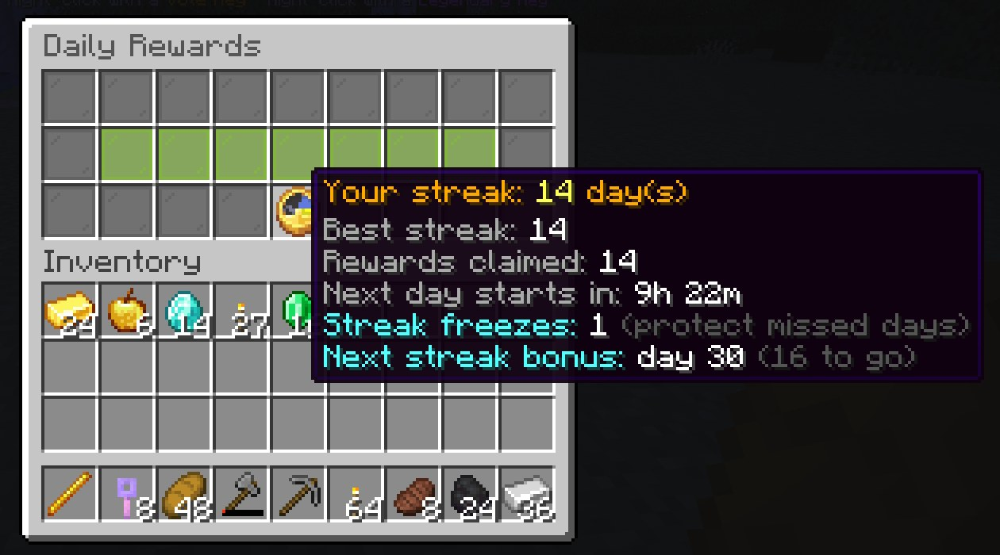
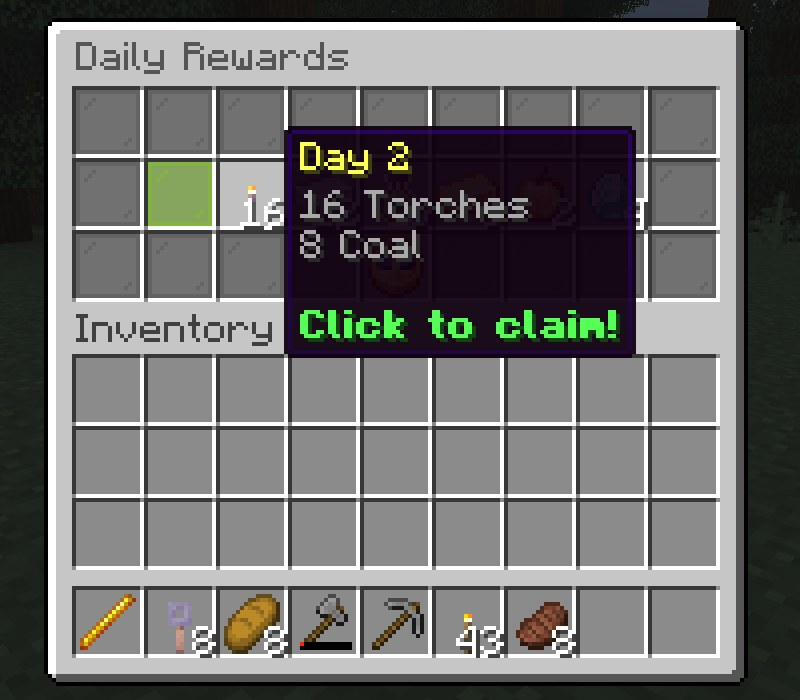
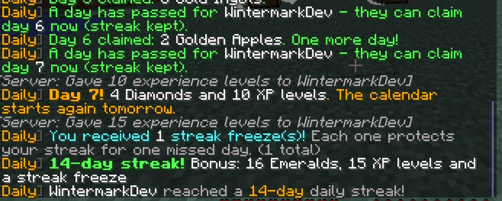
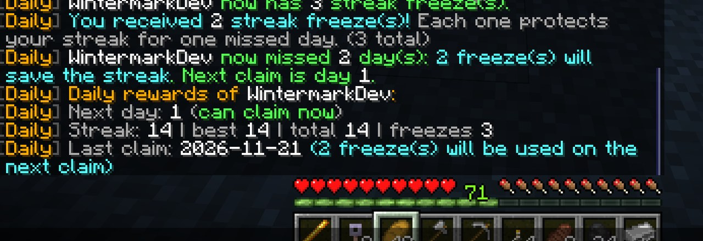
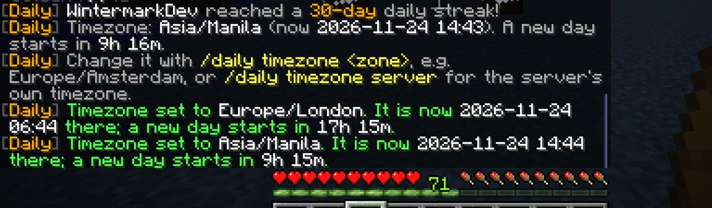

# Wintermark Daily Rewards

**Daily login rewards for Paper servers: a calendar menu, streaks, streak bonuses, streak freezes and join reminders.**
Give players a reason to come back every day, and let them protect a long streak when life gets in the way.



## Features

- **Calendar menu.** `/daily` opens a calendar with up to 28 days. Claimed days turn green, today's reward glows with "Click to claim!", future days show what's coming.
- **Streaks.** One claim per calendar day. Miss a day and the calendar starts over at day 1 (or keeps the player's place, your choice). Optional grace days for everyone.
- **Streak bonuses.** Extra rewards when a streak reaches 7, 14, 30 days... (any numbers you like), with server-wide broadcasts for the big ones.
- **Streak freezes.** Give a player freezes (as a reward, a vote reward, from a store or by hand). Each missed day uses one automatically and the streak survives.
- **Join reminder.** A chat message with a clickable **[CLAIM]** button when today's reward is waiting, or open the calendar automatically.
- **Timezone.** A new day starts at midnight in the timezone you choose, set in-game with `/daily timezone`.
- **Admin tools.** View a player's data, restore a streak, set the day, give freezes, full reset. Test tools to simulate days without waiting.
- **Fully configurable.** Days, rewards (items and console commands), bonuses, sounds and every message, with MiniMessage colors. New settings are added to your config automatically on updates.
- **Lightweight.** No dependencies. Data in one small YAML file.

| Claim today's reward | Join reminder |
|---|---|
|  |  |

| Streak bonus with a freeze and a broadcast | Freezes protect a missed day |
|---|---|
|  |  |



## Requirements

- **Paper 26.3** (or a Paper fork such as Purpur) with **Java 25**
- Not tested on Folia or Spigot

## Installation

1. Download `WintermarkDaily-1.0.0.jar` and put it in your server's `plugins` folder.
2. Start the server. `plugins/WintermarkDaily/config.yml` is created with a 7-day calendar and bonuses at 7, 14 and 30 days.
3. Set your timezone: `/daily timezone Europe/Amsterdam` (or keep the server's timezone).
4. Players type `/daily`, or click **[CLAIM]** when they join.

## Commands

Main command `/daily`, alias `/dailyrewards`.

| Command | Description | Permission |
|---|---|---|
| `/daily` | Open the reward calendar | `wintermark.daily.use` |
| `/daily info <player>` | Day, streak, best, total, freezes, last claim | `wintermark.daily.admin` |
| `/daily freezes <give\|take\|set> <player> <amount>` | Streak freezes (works from the console) | `wintermark.daily.admin` |
| `/daily setstreak <player> <days>` | Restore or change a streak | `wintermark.daily.admin` |
| `/daily setday <player> <day>` | Set the next calendar day | `wintermark.daily.admin` |
| `/daily reset <player>` | Full reset (day, streak, best, total, freezes) | `wintermark.daily.admin` |
| `/daily timezone [zone\|server]` | Show or set when a new day starts | `wintermark.daily.admin` |
| `/daily nextday <player>` | Testing: pretend a day has passed | `wintermark.daily.admin` |
| `/daily missday <player> [days]` | Testing: pretend days were missed | `wintermark.daily.admin` |
| `/daily reload` | Reload `config.yml` | `wintermark.daily.admin` |

**Permissions**

| Permission | Default | Description |
|---|---|---|
| `wintermark.daily.use` | everyone | Open the calendar and claim rewards |
| `wintermark.daily.admin` | op | All admin commands |

## Configuration

The default config is commented line by line. The main sections:

```yaml
timezone: ""          # e.g. Europe/Amsterdam; empty = server timezone
streak:
  on-miss: RESET      # RESET = back to day 1, KEEP = keep the calendar position
  grace-days: 0       # free missed days for everyone
  max-freezes: 0      # max streak freezes per player, 0 = no limit
  after-last-day: LOOP  # LOOP or REPEAT-LAST
join:                 # reminder, open-menu, delay-seconds
sounds:               # claim, reminder, click, bonus
days:                 # the calendar, see below
streak-bonuses:       # extra rewards at streak milestones, see below
messages:             # every message
```

Example day and streak bonus:

```yaml
days:
  7:
    display-name: "<gold><bold>Day 7 - Big reward"
    display-lore: ["<gray>4 Diamonds", "<gray>$500"]
    display: "DIAMOND:4"
    items: ["DIAMOND:4"]
    commands: ["eco give <player> 500"]
    message: "<gold>Day 7! 4 Diamonds and $500."

streak-bonuses:
  14:
    items: ["EMERALD:16"]
    commands: ["daily freezes give <player> 1", "crate givekey <player> vote 1"]
    message: "<green>14-day streak! 16 Emeralds, a streak freeze and a Vote Key."
    broadcast: true
```

Text uses [MiniMessage](https://docs.advntr.dev/minimessage/format.html). Placeholders: `<player>`, `<day>`, `<days>`, `<streak>`, `<best>`, `<total>`, `<freezes>`, `<time>`, `<next-bonus>`, `<bonus-left>`. Set any message to `""` to turn it off.

## FAQ

**When does a new day start?**
At midnight in the configured timezone. `/daily timezone` shows the current time there and how long until the next day.

**What is the difference between grace days and freezes?**
Grace days count for every player and never run out. Freezes belong to one player and are used up: one per missed day. Grace days are used first.

**Can I give freezes as a reward?**
Yes. Run `daily freezes give <player> 1` as a console command, for example in a streak bonus, a vote reward, a crate reward or a store package.

**Works with my other plugins?**
Rewards are console commands, so they work with any economy, crate, rank or vote plugin. It pairs well with [Wintermark Crates](https://github.com/wintermarkinteractive/WintermarkCrates) (crate keys as daily rewards).

**Where is data stored?**
`plugins/WintermarkDaily/data.yml`, saved after every claim.

## Building from source

```
git clone https://github.com/wintermarkinteractive/WintermarkDaily.git
cd WintermarkDaily
./gradlew build
```

The jar is in `build/libs/`. Requires JDK 25.

## License

[MIT](LICENSE)

---

**Wintermark Interactive** - game mods, plugins and systems.
Designed, tested and maintained by Wintermark Interactive.
Custom plugins and server setups: wintermarkinteractive@gmail.com
